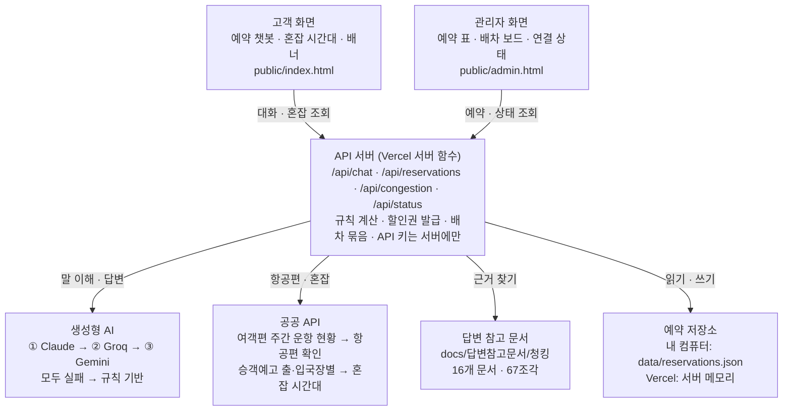
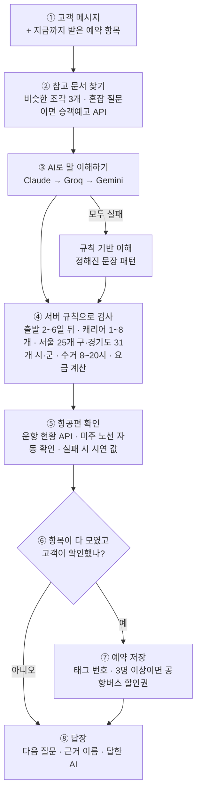
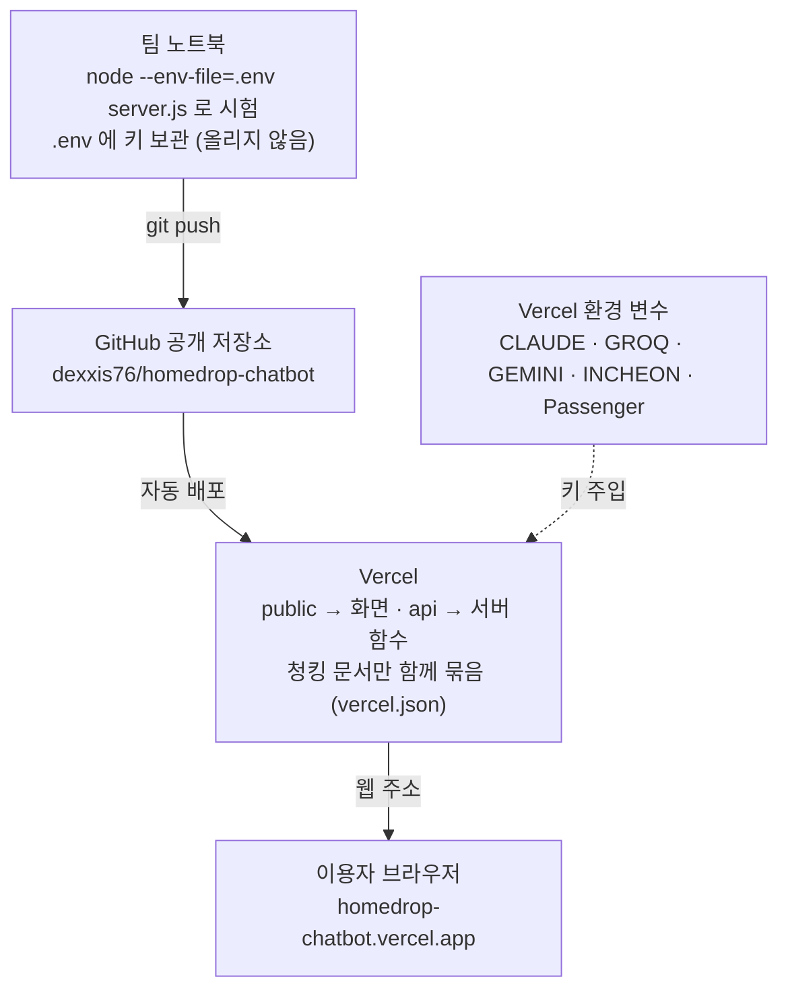

# 홈드랍 예약·안내 챗봇 (데모)

집에서 캐리어를 수거해 인천국제공항까지 보내 주는 「홈드랍」을 **대화로 예약**하고, 운영자는 **관리자 화면**에서 예약과 배차를 한눈에 보는 생성형 AI 챗봇 데모입니다.

- 사이트: https://homedrop-chatbot.vercel.app
- 관리자 화면: https://homedrop-chatbot.vercel.app/admin
- 성격: 캡스톤디자인 「AI 기반 공공행정 프로젝트」 데모. 요금·수거 시간·배차·할인권 값은 **시연용 데모 값**이며 실제 서비스 기준이 아닙니다.

## 주요 기능

| 화면 | 기능 |
|---|---|
| 고객 화면 `/` | 예약 챗봇 (정보 → 주소 → 항공편 → 사전 확인 3가지 → 짐 → 동반 인원 → 수거 시각 → 확인), 요금·금지 물품·수거 시간 질문 답변, 출국장 혼잡 시간대 그래프, 홍보 배너(4초마다 넘김) |
| 관리자 화면 `/admin` | 예약 표, 배차 추천 보드(수거 차량 4대=1~4호차, 작업량이 비슷하도록 나눈 담당 구역과 쏠릴 때 이웃 호차로 재배정, 같은 수거일 × 2시간, 한 번에 최대 캐리어 40개), 예약 상태 4단계, 키·API 연결 상태 |
| 공항버스 가족 할인권 | 3명 이상 동반 가족이 예약하면 왕복 공항버스 할인권을 함께 발급 (시행 초기 이벤트 70%, 데모 값) |

- 답마다 근거 이름(참고 문서 또는 API 이름)을 붙이고, 데모 규칙 값에는 「데모 값」이라고 밝힙니다.
- 요금·날짜·개수·할인권 대상은 **서버 규칙이 계산**하고, AI는 말을 예약 항목으로 바꾸고 설명만 합니다. AI는 자격을 판정하지 않습니다.
- AI가 모두 실패해도 **규칙 기반 모드**로 같은 예약 흐름을 이어 갑니다.

## 시스템 설계도

### 전체 구성



### 챗봇 한 번의 처리 흐름 (`/api/chat`)



### 배포 구조



> 그림이 보이지 않으면 아래 「첨부」의 시스템 설계도 PDF를 열어 주세요.

## 사용한 API

| API | 기관 | 쓰는 곳 | .env 키 이름 |
|---|---|---|---|
| 여객편 주간 운항 현황 | 인천국제공항공사 (공공데이터포털) | 챗봇 항공편 확인 | `INCHEON` |
| 승객예고 출·입국장별 | 인천국제공항공사 (공공데이터포털) | 혼잡 시간대 그래프·답변 | `Passenger` |
| Claude / Groq / Gemini | Anthropic / Groq / Google | 말 이해·질문 답변 (이 순서로 시도) | `CLAUDE_API_KEY` / `GROQ_API_KEY` / `GEMINI_API_KEY` |

- 공공 API는 서버(`api`)에서만 부릅니다. 실패하면 이유(키 비어 있음 · 승인 안 됨 · 시간 초과)와 「시연 값」을 함께 보여 줍니다.
- 공공데이터포털 키는 Encoding · Decoding 둘 다 동작합니다.
- AI 모델 이름은 키로 모델 목록을 조회해 정합니다.

## 폴더 구조

```
api/                    서버 코드 (Vercel 서버 함수)
  chat.js               예약 대화 · 질문 답변
  reservations.js       예약 표 · 배차 · 상태 변경
  congestion.js         혼잡 시간대 (승객예고 API)
  status.js             키 · 연결 상태 (키 값은 내보내지 않음)
  _ai.js _public.js _docs.js _rules.js _store.js _util.js
public/                 화면 (그대로 공개됨)
  index.html app.js banner.js   고객 화면
  admin.html admin.js           관리자 화면
  banner/               홍보 배너 사진
docs/답변참고문서/청킹/    챗봇이 읽는 참고 문서 (서버는 이 폴더만 읽음)
server.js               내 컴퓨터 실행용 (public + /api)
vercel.json             배포 설정 (청킹 문서만 함께 묶음)
```

## 내 컴퓨터에서 실행

1. `.env` 파일에 위 「사용한 API」 표의 키 이름으로 값을 넣습니다. `.env`는 GitHub에 올리지 않습니다.
2. 아래 명령으로 실행하고 http://localhost:3000 을 엽니다.

```bash
node --env-file=.env server.js
```

## 한계

- 요금, 수거 시각, 배차 규칙, 할인권 할인율은 시연용 데모 값입니다. 실제 기준은 공항공사·항공사·운송사 협의가 필요합니다.
- Vercel에서는 예약이 서버 메모리에 있어, 서버가 쉬었다 깨면 처음 데모 예약으로 돌아갑니다.
- 실제 개인정보를 입력하지 마세요. 데모 예약의 이름·번호는 지어낸 값입니다.

## 참고 자료

- 공공데이터포털 — 인천국제공항공사 여객편 주간 운항 현황 (data.go.kr/data/15095074), 승객예고 출·입국장별 (data.go.kr/data/15095066)
- 경향신문 (2025.5.29) 「삼성역에서도 수하물 미리 부치고 체크인, 빈손 출국」
- 뉴스핌 (2025.5.30) 홈드랍 시범 운영 계획
- 경향신문 (2026.2.18) 「버스 왜 타? 승용차가 더 싸고 편한데」
- 머니투데이 (2026.2.8) 「주차가 버스보다 싸네」, (2026.4.28) T2 장기주차장 증설
- 인천국제공항공사 · 아시아나항공 · 롯데글로벌로지스 · 한국교통안전공단 항공보안365 · 국토교통부 안내 자료 (`docs/답변참고문서/청킹`)
- 이성웅, 「인천국제공항의 효율적인 접근 교통체계에 관한 소고」 / Chang, Y.-C. (2013), Transportation Research Part E, 57

## 첨부

- [홈드랍 시스템 설계도 (PDF)](./홈드랍%20시스템%20설계도.pdf)
